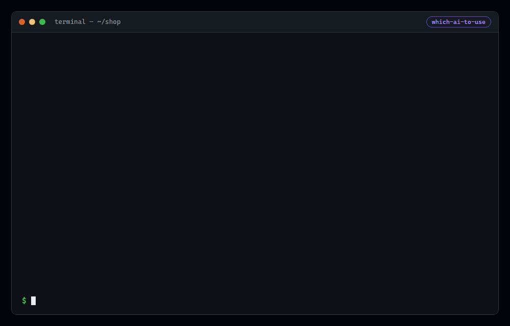
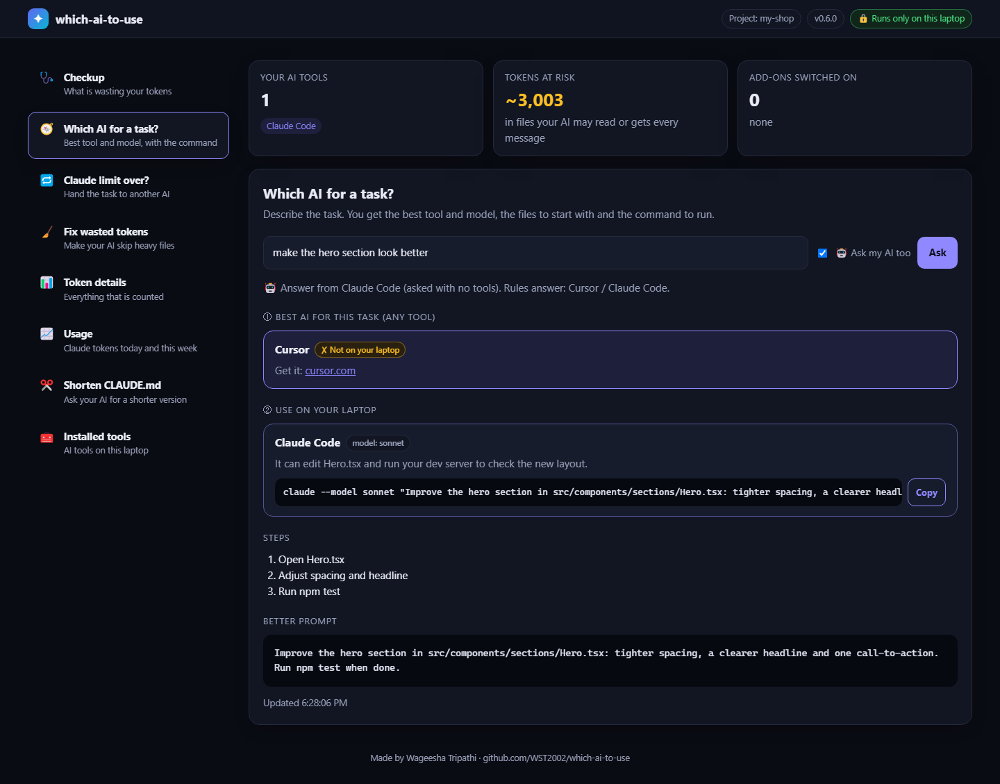

# which-ai-to-use

**Not a developer?** Use the website: [wst2002.github.io/which-ai-to-use](https://wst2002.github.io/which-ai-to-use/) — type any task (an essay, a logo, slides, a song, research, studying from your notes) and get the best AI app, the free option and a ready prompt. English and हिंदी, free, no signup.

Use your AI coding tools better. See what wastes your tokens, pick the right AI (and model) for each task, and hand a task to another AI when Claude's limit runs out.



*Real output on a demo project: checkup, fix, score, and a handoff when Claude's limit runs out.*

## Start here

Open a terminal in your project and run:

```bash
npx which-ai-to-use
```

```
✓ Checked: my-app

Your AI tools: Claude Code, Codex CLI

2 things are wasting your tokens:
  1. package-lock.json is ~57,820 tokens. Your AI can read it while searching.
     → Fix it:  npx which-ai-to-use fix
  2. 3 add-ons are switched on (github, notion, slack). Each one is sent with every message.
     → Turn off the ones you don't use, e.g. claude mcp remove github

Starting a task?      npx which-ai-to-use "your task"
Claude limit over?    npx which-ai-to-use handoff
```

That's it. The only other commands you need:

| When | Run |
|---|---|
| Starting a task | `npx which-ai-to-use "fix the login bug"` → which AI and model, with the command to run |
| Claude's limit ran out mid-task | `npx which-ai-to-use handoff "the task"` → another AI carries on |
| Fix what the checkup found | `npx which-ai-to-use fix` → your AI tools skip heavy files (asks first) |

Prefer buttons? Open everything in your browser:

```bash
npx which-ai-to-use dashboard
```


With **Ask my AI too** switched on, the dashboard asks an AI you already have for a smarter answer, after showing what will be sent:



The dashboard runs only on your laptop (127.0.0.1) and needs the private link printed in the terminal. Fix shows a preview and changes nothing until you click **Apply fix**.

Nothing is sent anywhere: it only looks at your laptop and your project.

**How good is your setup?** `npx which-ai-to-use score`. Add `--card` to open the score card image, ready to download and post:


## VS Code extension

The same features inside VS Code: a **Which AI** sidebar with the full dashboard (score, checkup, fix, task advice, handoff, score card), the score and tokens at risk in the status bar, and **Which AI** commands in the Command Palette. It lives in [`extension/`](extension) and is tested inside a real VS Code. Marketplace listing coming soon; until then build it with `cd extension && npm ci && npm run package` and install the `.vsix` (Extensions → … → Install from VSIX).

## Install

You don't have to install anything. Pick the way that suits you:

| | Command | When to use it |
|---|---|---|
| **1. Run with npx** (recommended) | `npx which-ai-to-use` | Now and then. Nothing is installed and you always get the latest version. |
| **2. Install globally** | `npm i -g which-ai-to-use` | Every day. Afterwards `which-ai-to-use` and `which-ai-to-use dashboard` work in any folder without npx. |
| **3. Install in a project** | `npm i which-ai-to-use` | Not recommended: it adds a dependency to your app's `package.json` for a tool your app never uses. |

**Update**

- npx: nothing to do, it fetches the latest version. If an old one is cached, run `npx which-ai-to-use@latest`.
- Global install: `npm i -g which-ai-to-use@latest`. Check your version with `which-ai-to-use --version`.

**Uninstall**

- Global install: `npm uninstall -g which-ai-to-use`.
- npx leaves nothing in your project. To clear its download cache: `npm cache clean --force`.

## Everything it does

| | |
|---|---|
| **Recommend** | First the best AI for the task among every supported tool (and whether it is on your laptop), then the best of the ones you have, with a reason for that kind of task and the command to run |
| **AI mode** | `--ai`: with your permission, asks an AI you already have (Ollama first, then Claude Code, Gemini CLI, Codex) for a smarter answer and a better prompt. It runs with no tools, gets the task and file **names** only, and the rules answer is shown alongside |
| **Cost to start** | Rough tokens the first message will take: the tool's instructions file, the files the prompt points at, the prompt |
| **Usage** | `usage`: when your current 5-hour Claude limit window resets (an estimate) and the tokens used in it, Claude Code tokens today and in the last 7 days, busiest projects, and a tip when today is far above average. Read from Claude Code's own logs: numbers only, never your messages |
| **Slim** | `slim`: your AI writes a shorter copy of a long `CLAUDE.md` next to it (it sends the file, so it asks first); `slim --apply` swaps it in and keeps a backup |
| **Better prompt** | Names the files that match the task and asks the agent to run your tests and report the result |
| **Model choice** | For Claude Code: `--model haiku` for small edits (uses far less of your limit), `--model opus` for risky or large work |
| **Dashboard** | `dashboard`: every command as a button in your browser, on localhost only |
| **Score** | `score`: your AI setup out of 100 with a grade, what costs points (each with a fix), the tokens a fix saves, and a line to share. The dashboard draws it as an image to post |
| **Checkup** | `npx which-ai-to-use`: your AI tools and, in plain words, what wastes tokens with one fix each |
| **Fix** | `fix`: makes each installed AI skip heavy files (Claude Code deny rules, `.cursorignore`, `.geminiignore`, `.aiderignore`), after asking |
| **Token details** | `tokens`: instructions files sent with every message (and their biggest sections), heavy files, add-ons (MCP servers) |
| **Handoff** | Hit a usage limit mid-task? `handoff` writes `HANDOFF.md` (task, commits, changed files, how to verify) so the next AI continues instead of starting over |
| **Limit reached** | `--without claude-code` recommends the next best tool |
| **Second opinion** | For risky tasks (security, payments, auth, migrations, refactors), a review command for a *different* AI |
| **Privacy mode** | `.env` or private keys in the project → local tools (Ollama) ranked first, cloud tools flagged |
| **Budget** | `--prefer free` ranks free and local tools first; `--prefer quality` ranks the most capable agents first |
| **Doctor** | Which AI tools are installed and which instructions files this project has |
| **Sync instructions** | One `AGENTS.md` → the same instructions in `CLAUDE.md`, `GEMINI.md`, Cursor, Copilot, Windsurf and Cline files |

## Commands

```bash
npx which-ai-to-use                     # checkup
npx which-ai-to-use "<task>"            # recommend
npx which-ai-to-use "<task>" --ai       # also ask an AI you have (asks permission first)
npx which-ai-to-use fix                 # make your AI tools skip heavy files (asks first)
npx which-ai-to-use usage               # when Claude's 5-hour window resets, tokens today and this week
npx which-ai-to-use score               # your AI setup score out of 100, ready to share
npx which-ai-to-use slim                # shorter CLAUDE.md written by your AI (asks first)
npx which-ai-to-use dashboard           # the same as buttons in your browser
npx which-ai-to-use tokens              # find what wastes tokens in this project
npx which-ai-to-use handoff "<task>"    # switching AI mid-task: write HANDOFF.md for the next one
npx which-ai-to-use doctor              # what is installed
npx which-ai-to-use sync                # share AGENTS.md with every installed AI
```

Options: `--prefer balanced|free|quality`, `--private`, `--without <tool>`, `--ai`, `--json`, `--yes` (for `fix`, `sync`, `slim` and `--ai`), `--apply` (for `slim`), and for `sync`: `--from <file>`, `--all`.

## Save tokens

```
npx which-ai-to-use tokens
```

```
Instructions files (sent with every message)
  ! CLAUDE.md                         ~6,200 tokens  (over 2,000: trim it)
      Largest sections: Setup ~4,000 tokens · Style ~1,200 tokens · Project ~300 tokens

Heavy files an agent may read (~57,820 tokens in total)
  package-lock.json                   ~57,820 tokens

  Tell your AI tools to skip them:
  Claude Code → .claude/settings.json
      { "permissions": { "deny": ["Read(./package-lock.json)"] } }

Add-ons (MCP servers) switched on: each one is sent with every message
  Claude Code: github, notion, slack
  Turn off the ones you don't use in this project.
```

Token counts are estimates (about four characters per token). `tokens` changes nothing; `npx which-ai-to-use fix` applies the skip rules after asking.

## Switch AI mid-task

Claude hit its limit halfway through a feature? Hand the work to another tool without starting over:

```
npx which-ai-to-use handoff "add coupon codes to the cart"
```

```
Wrote HANDOFF.md: 3 changed file(s), 1 commit(s) on feat/coupons.

Left out: Claude Code (limit over). Handing off from another AI? Add --without <tool>.

Next:    Gemini CLI — terminal agent: edits many files and runs your commands; free tier
Run:     gemini -i "Read HANDOFF.md and continue the task."
```

`HANDOFF.md` lists the task, the commits on the branch, every uncommitted file with its line counts, and the test command to run first. The next AI reads a short note instead of re-exploring the whole project. Don't commit it.

Claude Code is left out by default, since its limit is what ran out. Coming from another AI? Name that one instead, for example `--without codex`. Only Claude installed? Handoff still writes the note and tells you how to carry on: paste `HANDOFF.md` into ChatGPT or Gemini on the web, or install Gemini CLI (free tier). Add `--copy` to put the note straight on your clipboard; the dashboard and the VS Code sidebar have a **Copy HANDOFF.md** button.

## Supported tools

Claude Code · Codex CLI · Gemini CLI · Cursor · GitHub Copilot · Windsurf · Cline · Aider · Ollama

Tools are detected from commands on your `PATH`, their settings folders and VS Code/Cursor extensions. Nothing is sent over the network. `tokens` reads MCP config files (such as `~/.claude.json`) only for server names; keys and other values in them are never shown or stored.

Capabilities in [`data/tools.json`](data/tools.json) describe features (terminal agent, inline edits, large context, local, free tier), not opinions about model quality, and carry an "as of" date.

## Use inside your AI

The [`skills/which-ai-to-use`](skills/which-ai-to-use) skill lets you ask any agent that supports skills: *"which AI should I use for this?"*

## Requirements

Node.js 18 or newer.

## License

MIT © Wageesha Tripathi

---

Made by **Wageesha Tripathi** · [LinkedIn](https://www.linkedin.com/in/wst2002/) · [Email](mailto:tripathiwageesha2002@gmail.com) · [GitHub](https://github.com/WST2002)
