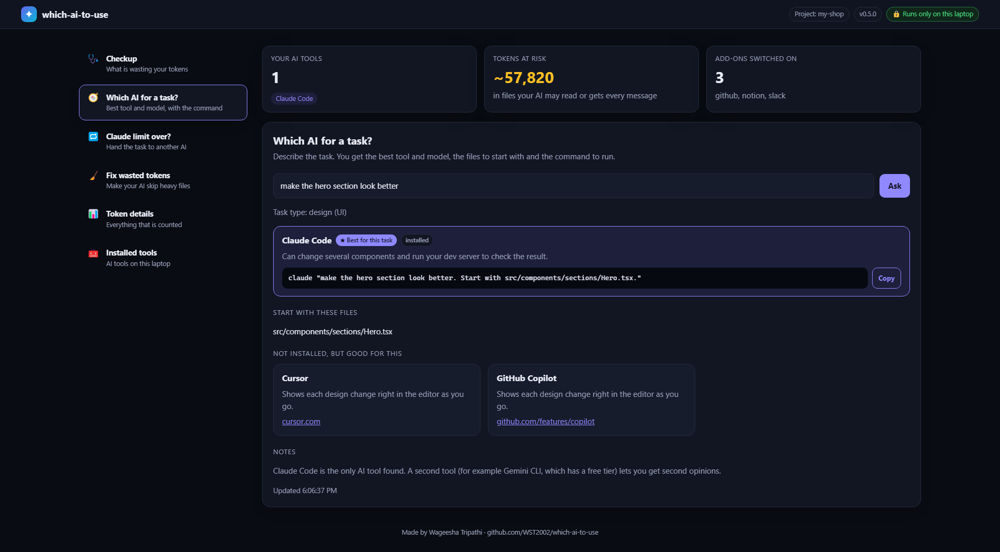
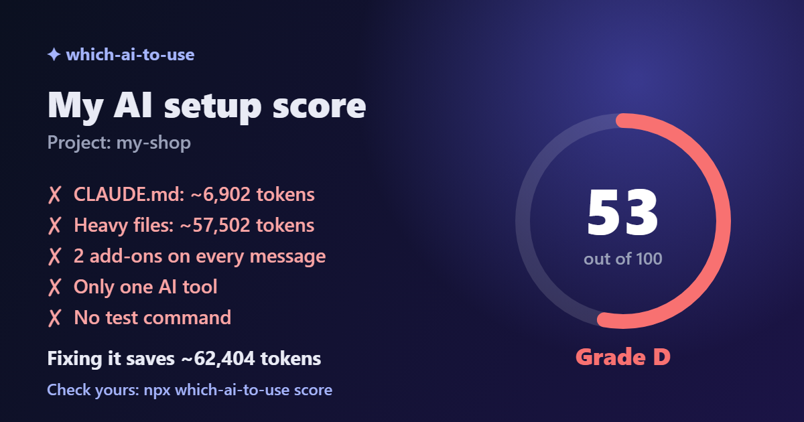
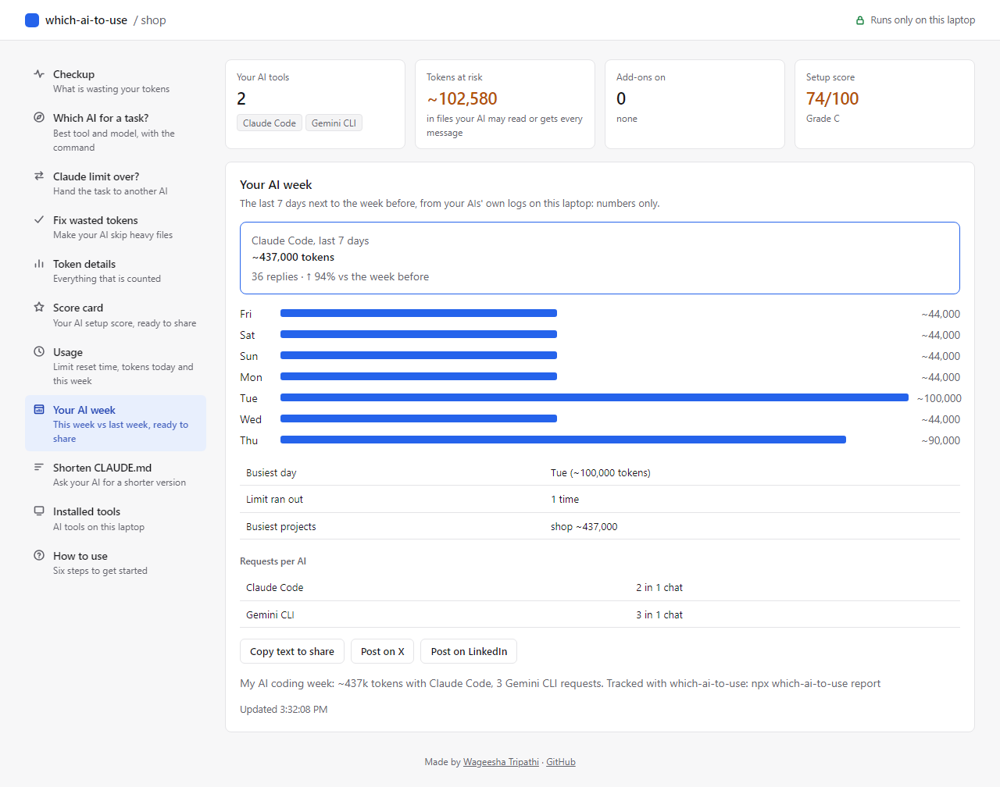
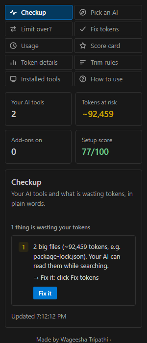

# which-ai-to-use

[](https://www.npmjs.com/package/which-ai-to-use) [](https://marketplace.visualstudio.com/items?itemName=wst2002.which-ai-to-use) [](https://open-vsx.org/extension/wst2002/which-ai-to-use) [](https://www.youtube.com/@wst2002rk)

**Get it:** `npx which-ai-to-use` ([npm](https://www.npmjs.com/package/which-ai-to-use)) · VS Code: [Marketplace](https://marketplace.visualstudio.com/items?itemName=wst2002.which-ai-to-use) · Cursor and Windsurf: [Open VSX](https://open-vsx.org/extension/wst2002/which-ai-to-use) · Claude Code plugin: [limit-handoff](#claude-code-plugin-hand-off-the-moment-the-limit-hits)

📖 You can also read the story behind it on dev.to: [Stuck when your AI hits its usage limit mid-task? I made a tool to switch AIs without losing context](https://dev.to/wst2002rk/how-i-switch-between-ai-coding-tools-mid-task-without-losing-context-codex-claude-code-gemini-37kf) · Also on Reddit: [r/coolgithubprojects](https://www.reddit.com/r/coolgithubprojects/comments/1xcifvm/i_built_a_free_tool_that_tells_you_which_ai/)

**Not a developer?** Use the website: [wst2002.github.io/which-ai-to-use](https://wst2002.github.io/which-ai-to-use/) — type any task (an essay, a logo, slides, a song, research, studying from your notes) and get the best AI app, the free option and a ready prompt. English and हिंदी, free, no signup.

Use your AI coding tools better. See what wastes your tokens, pick the right AI (and model) for each task, make Claude's limit last, hand a task to another AI when it runs out, and see your AI week.


*Real output on a demo project: checkup, fix, score, the limit warning with tips, a handoff that reads the chat, and your AI week.*

▶ [Watch the 36-second handoff demo on YouTube](https://youtube.com/shorts/LCt2H7bFwLg)

## Start here

Open a terminal in your project and run:

```bash
npx which-ai-to-use
```

```
✓ Checked: my-app

Your AI tools: Claude Code, Codex CLI

2 things are wasting your tokens:
  1. package-lock.json is ~57,820 tokens. Your AI can read it while searching.
     → Fix it:  npx which-ai-to-use fix
  2. 3 add-ons are switched on (github, notion, slack). Each one is sent with every message.
     → Turn off the ones you don't use, e.g. claude mcp remove github

Starting a task?      npx which-ai-to-use "your task"
Claude limit over?    npx which-ai-to-use handoff
```

No AI coding tool on your laptop yet? The checkup asks what you want to do and suggests the AI that suits it, a free option, and how to install each; it can install one and start your task in it. The dashboard and the VS Code sidebar do the same.

That's it. The only other commands you need:

| When | Run |
|---|---|
| Starting a task | `npx which-ai-to-use "fix the login bug"` → which AI and model, with the command to run |
| Claude's limit ran out mid-task | `npx which-ai-to-use handoff "the task"` → another AI carries on |
| Fix what the checkup found | `npx which-ai-to-use fix` → your AI tools skip heavy files (asks first) |

Prefer buttons? Open everything in your browser:

```bash
npx which-ai-to-use dashboard
```



With **Ask my AI too** switched on, the dashboard asks an AI you already have for a smarter answer, after showing what will be sent. New here? Open **How to use** in the menu.

The dashboard runs only on your laptop (127.0.0.1) and needs the private link printed in the terminal. Fix shows a preview and changes nothing until you click **Apply fix**.

Nothing is sent anywhere: it only looks at your laptop and your project.

**How good is your setup?** `npx which-ai-to-use score`. Add `--card` to open the score card image, ready to download and post:



**How was your week?** `npx which-ai-to-use report`, or **Your AI week** in the dashboard: tokens per day next to the week before, how often the limit ran out, and requests per AI, with a line to share:



## VS Code extension



The same features inside VS Code: a **Which AI** sidebar with the full dashboard (score, checkup, fix, task advice, handoff, score card, your AI week), the score and tokens at risk in the status bar, and **Which AI** commands in the Command Palette. A short **Get started** tour opens after you install it. It lives in [`extension/`](extension) and is tested inside a real VS Code. Install it with `npx which-ai-to-use setup`, which also sets up the terminal command.

<br clear="right">

## Install

You don't have to install anything. Pick the way that suits you:

| | Command | When to use it |
|---|---|---|
| **1. Run with npx** (recommended to try it) | `npx which-ai-to-use` | Now and then. Nothing is installed and you always get the latest version. |
| **2. Terminal and editor in one go** | `npx which-ai-to-use setup` | Every day. Installs the `which-ai-to-use` command and adds the **Which AI** sidebar to VS Code, Cursor or Windsurf. It asks before each step; add `--yes` to skip the questions. |
| **3. Install globally** | `npm i -g which-ai-to-use` | Terminal only. Afterwards `which-ai-to-use` and `which-ai-to-use dashboard` work in any folder without npx. |
| **4. Install in a project** | `npm i which-ai-to-use` | Not recommended: it adds a dependency to your app's `package.json` for a tool your app never uses. |

`setup` installs the editor extension from the editor's own extension store when it is listed there, and otherwise from a copy inside the npm package, so it works offline and in editors with another store. It needs the editor's command on your PATH (`code`, `cursor` or `windsurf`); VS Code on Windows and Linux adds it during installation, and on macOS you add it from the Command Palette with **Shell Command: Install 'code' command in PATH**.

**Update**

- npx: nothing to do, it fetches the latest version. If an old one is cached, run `npx which-ai-to-use@latest`.
- Global install and the editor sidebar: run `npx which-ai-to-use@latest setup` again. Check your version with `which-ai-to-use --version`.

**Uninstall**

- Global install: `npm uninstall -g which-ai-to-use`.
- Editor sidebar: `code --uninstall-extension wst2002.which-ai-to-use` (or `cursor` / `windsurf`), or uninstall it from the Extensions view.
- npx leaves nothing in your project. To clear its download cache: `npm cache clean --force`.

## Everything it does

| | |
|---|---|
| **Recommend** | First the best AI for the task among every supported tool (and whether it is on your laptop), then the best of the ones you have, with a reason for that kind of task and the command to run |
| **AI mode** | `--ai`: with your permission, asks an AI you already have (Ollama first, then Claude Code, Antigravity CLI, Gemini CLI, Codex) for a smarter answer and a better prompt. It runs with no tools, gets the task and file **names** only, and the rules answer is shown alongside |
| **Cost to start** | Rough tokens the first message will take: the tool's instructions file, the files the prompt points at, the prompt |
| **Usage** | `usage`: when your current 5-hour Claude limit window resets (an estimate) and the tokens used in it, when you reach the limit at the pace of the last half hour (if that comes before the reset, also in the VS Code status bar as `limit in ~40m`), a warning when the window nears your busiest one this week (or where your limit ran out before, once the Claude Code plugin has recorded it), also in the VS Code status bar, Claude Code tokens today and in the last 7 days, busiest projects, a tip when today is far above average, and when the window is close, four ways to make it last, each with its command. Read from Claude Code's own logs: numbers only, never your messages |
| **Your AI week** | `report`: Claude Code tokens per day for the last 7 days next to the week before, the busiest day and projects, how often the limit ran out, requests in Claude Code, Codex CLI and Gemini CLI, and a line to share with links to post. Numbers only, never your messages; also in the dashboard |
| **Slim** | `slim`: your AI writes a shorter copy of a long `CLAUDE.md` next to it (it sends the file, so it asks first); `slim --apply` swaps it in and keeps a backup |
| **Recent tasks** | `recent`: the tasks you asked about in this project with the AI suggested for each, newest first. The dashboard and VS Code offer them again in one click. Kept only on this laptop (`~/.which-ai-to-use/tasks.jsonl`, secrets hidden) |
| **Better prompt** | Names the files that match the task and asks the agent to run your tests and report the result |
| **Model choice** | For Claude Code: `--model haiku` for small edits (uses far less of your limit), `--model opus` for risky or large work |
| **Dashboard** | `dashboard`: every command as a button in your browser, on localhost only |
| **Score** | `score`: your AI setup out of 100 with a grade, what costs points (each with a fix), the tokens a fix saves, and a line to share, with links that open a post on X or LinkedIn already filled in. The dashboard draws it as an image to post |
| **Checkup** | `npx which-ai-to-use`: your AI tools and, in plain words, what wastes tokens with one fix each. In a terminal it then offers to fix it right away (y/N) and shows the new score; in the dashboard and VS Code, **Fix it now** does it in one click |
| **Fix** | `fix`: makes each installed AI skip heavy files (Claude Code deny rules, `.cursorignore`, `.geminiignore`, `.aiderignore`), after asking |
| **Team** | `team`: writes the project's heavy files to `.which-ai.json` after asking. Commit it, and every teammate's `fix` skips the same files. The file can also set the ranking (`"prefer": "free"`) and tools to leave out (`"without": ["codex"]`); flags still win |
| **Token details** | `tokens`: instructions files sent with every message (and their biggest sections), heavy files, add-ons (MCP servers) |
| **Handoff** | Hit a usage limit mid-task? `handoff` writes `HANDOFF.md` (task, commits, changed files, how to verify) so the next AI continues instead of starting over |
| **Limit reached** | `--without claude-code` recommends the next best tool |
| **Second opinion** | For risky tasks (security, payments, auth, migrations, refactors), a review command for a *different* AI |
| **Privacy mode** | `.env` or private keys in the project → local tools (Ollama) ranked first, cloud tools flagged |
| **Budget** | `--prefer free` ranks free and local tools first; `--prefer quality` ranks the most capable agents first |
| **Doctor** | Which AI tools are installed and which instructions files this project has |
| **Sync instructions** | One `AGENTS.md` → the same instructions in `CLAUDE.md`, `GEMINI.md`, Cursor, Copilot, Windsurf and Cline files |

## Commands

```bash
npx which-ai-to-use                     # checkup
npx which-ai-to-use "<task>"            # recommend
npx which-ai-to-use "<task>" --ai       # also ask an AI you have (asks permission first)
npx which-ai-to-use fix                 # make your AI tools skip heavy files (asks first)
npx which-ai-to-use usage               # when Claude's 5-hour window resets, when you reach the limit at this pace
npx which-ai-to-use recent              # tasks you asked about here, to ask one again
npx which-ai-to-use score               # your AI setup score out of 100, ready to share
npx which-ai-to-use slim                # shorter CLAUDE.md written by your AI (asks first)
npx which-ai-to-use dashboard           # the same as buttons in your browser
npx which-ai-to-use tokens              # find what wastes tokens in this project
npx which-ai-to-use handoff "<task>"    # switching AI mid-task: write HANDOFF.md for the next one
npx which-ai-to-use doctor              # what is installed
npx which-ai-to-use sync                # share AGENTS.md with every installed AI
```

Options: `--prefer balanced|free|quality`, `--private`, `--without <tool>`, `--ai`, `--json`, `--yes` (for `fix`, `sync`, `slim` and `--ai`), `--apply` (for `slim`), and for `sync`: `--from <file>`, `--all`.

## Save tokens

```
npx which-ai-to-use tokens
```

```
Instructions files (sent with every message)
  ! CLAUDE.md                         ~6,200 tokens  (over 2,000: trim it)
      Largest sections: Setup ~4,000 tokens · Style ~1,200 tokens · Project ~300 tokens

Heavy files an agent may read (~57,820 tokens in total)
  package-lock.json                   ~57,820 tokens

  Tell your AI tools to skip them:
  Claude Code → .claude/settings.json
      { "permissions": { "deny": ["Read(./package-lock.json)"] } }

Add-ons (MCP servers) switched on: each one is sent with every message
  Claude Code: github, notion, slack
  Turn off the ones you don't use in this project.
```

Token counts are estimates (about four characters per token). `tokens` changes nothing; `npx which-ai-to-use fix` applies the skip rules after asking.

## Claude Code plugin: hand off the moment the limit hits

Install it once inside Claude Code:

```
/plugin marketplace add WST2002/which-ai-to-use
/plugin install limit-handoff@which-ai-to-use
```

When a turn ends because Claude's usage limit was reached, the plugin writes `HANDOFF.md` (copied to your clipboard) and shows a desktop notification, so you can carry on in another AI right away. It writes the note once per limit window, not on every message you send while the limit is over. It also records the time, which makes the limit warning in `usage` more accurate and counts in `report`.

With the VS Code extension, a notification offers **Continue in** the recommended AI, and once the limit resets, **Hand back to Claude**. From a terminal: `npx which-ai-to-use handoff --back`.

See the limit coming? Type `/limit-handoff:handoff` in Claude Code, optionally followed by the task. Claude writes `HANDOFF.md` with the tool and then adds a short **Notes from Claude** section: what is done, the next steps, decisions and what to watch out for. The next AI then knows what only Claude knew.

## Switch AI mid-task

Claude hit its limit halfway through a feature? Hand the work to another tool without starting over:

```
npx which-ai-to-use handoff "add coupon codes to the cart"
```

```
Wrote HANDOFF.md: 3 changed file(s), 1 commit(s) on feat/coupons.

Left out: Claude Code (limit over). Handing off from another AI? Add --without <tool>.

Next:    Antigravity CLI — terminal agent: edits many files and runs your commands; free tier
Run:     agy -i "Read HANDOFF.md and continue the task."
```

`HANDOFF.md` lists the task, the commits on the branch (on `main` without a branch: the latest commits, marked as recent), every uncommitted file with its line counts, and the test command to run first. The next AI reads a short note instead of re-exploring the whole project. Don't commit it. No git in the folder? The note lists the files the AI changed in its chat instead.

In a terminal, handoff then asks who carries on: the recommended AI first (with the reason), the other AIs you have, a chat on the web (the note is copied for you, with the changes themselves, since a web chat cannot open your project), any other AI you name, or nothing for now. Handoff only lists AIs it finds on your laptop; if a better one is not installed, it shows it too, with its official install command, and installs it only if you say yes. Press Enter for the recommended one and it starts right there with the note. Skip the question with `--to antigravity-cli`, `--to web` or `--to none`. In the dashboard and the VS Code sidebar the same choices are buttons; in VS Code, **Run in terminal** starts the AI in a VS Code terminal.

No need to type the task when you worked in Claude Code, Codex CLI or Gemini CLI: handoff reads the chat for this project from that AI's own log on your laptop (the AI whose limit ran out, or else the newest chat) and adds the first request, the latest requests and where the AI stopped. Passwords, API keys and tokens in the chat are replaced with `[hidden]`, and the note stays on your laptop until you hand it to the next AI.

Claude Code is left out by default, since its limit is what ran out. Coming from another AI? Name that one instead, for example `--without codex`. Only Claude installed? Handoff still writes the note and tells you how to carry on: paste `HANDOFF.md` into ChatGPT or Gemini on the web, or install Antigravity CLI (free tier). Add `--copy` to put the note and the changes straight on your clipboard; the dashboard and the VS Code sidebar have a **Copy note and changes** button. Files like `.env` and keys are never copied, and passwords and keys in the changes are replaced with `[hidden]`.

## Supported tools

Claude Code · Codex CLI · Antigravity CLI · Gemini CLI · Cursor · GitHub Copilot · Windsurf · Cline · Aider · Ollama

**Gemini CLI and a personal Google account:** Google stopped serving Gemini CLI to personal Google accounts (and Google AI Pro and Ultra) on 18 June 2026. If your Gemini CLI signs in that way, which-ai-to-use leaves it out, says so, and suggests Antigravity CLI (`agy`, Google's replacement, with a free tier) instead. Gemini CLI with a paid Gemini API key still counts.

A tool counts as installed when its command is on your `PATH` or its VS Code/Cursor extension is installed (editor apps like Cursor and Windsurf also by their settings folder). A settings folder alone, like `~/.claude` left after an uninstall or `~/.gemini` (which Antigravity CLI uses too), shows up only in `doctor`. Nothing is sent over the network. `tokens` reads MCP config files (such as `~/.claude.json`) only for server names; keys and other values in them are never shown or stored.

Capabilities in [`data/tools.json`](data/tools.json) describe features (terminal agent, inline edits, large context, local, free tier), not opinions about model quality, and carry an "as of" date.

## Use inside your AI

The [`skills/which-ai-to-use`](skills/which-ai-to-use) skill lets you ask any agent that supports skills: *"which AI should I use for this?"*

## Requirements

Node.js 18 or newer.

## License

MIT © Wageesha Tripathi

---

Made by **Wageesha Tripathi** · [LinkedIn](https://www.linkedin.com/in/wst2002/) · [Email](mailto:tripathiwageesha2002@gmail.com) · [GitHub](https://github.com/WST2002) · [YouTube](https://www.youtube.com/@wst2002rk)
